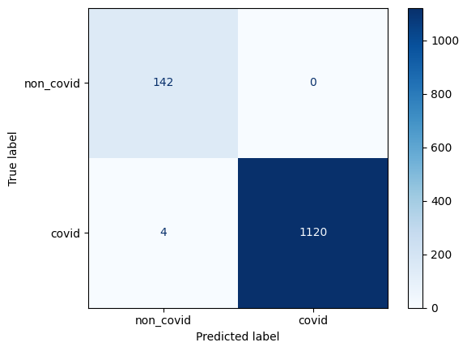
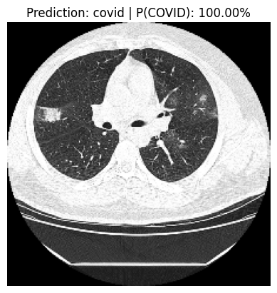

# Klasifikasi Citra CT Paru COVID-19

[English](README.md) | [Bahasa Indonesia](README.id.md)

Dalam proyek ini, saya melatih model klasifikasi gambar untuk mengelompokkan citra CT paru individual sebagai COVID-19 atau non-COVID-19.

Saya menggunakan **EfficientNetV2B0 pretrained pada ImageNet**. Pertama, saya melatih classifier baru dengan backbone dibekukan. Setelah itu, saya membuka backbone dan melakukan fine-tuning menggunakan data training.

## Dataset

[COVID-19 Lung CT Scans di Kaggle](https://www.kaggle.com/datasets/mehradaria/covid19-lung-ct-scans)

| Kelas | Jumlah gambar |
|---|---:|
| `non_covid` | 944 |
| `covid` | 7.495 |
| Total | 8.439 |

Saya menggunakan stratified split tetap: 5.907 gambar training, 1.266 validation, dan 1.266 test. Karena jumlah kelas tidak seimbang, saya menerapkan class weight saat training dan menggunakan macro-F1 sebagai metrik evaluasi utama. Dataset diunduh secara terpisah.

## Training

Saya mengubah gambar grayscale menjadi tiga kanal dan mengubah ukurannya menjadi 224 × 224. Preprocessing sudah ada dalam EfficientNetV2B0. Horizontal flip dan rotasi acak kecil digunakan sebagai augmentasi saat training.

| Parameter | Nilai |
|---|---:|
| Batch size | 16 |
| Pelatihan classifier | 2 epoch, Adam, learning rate `1e-3` |
| Fine-tuning | Maksimal 23 epoch, AdamW |
| Learning rate fine-tuning | `6e-5` |
| Weight decay | `1e-5` |
| Dropout | 0,4 |
| Patience early stopping | 5 epoch |
| Threshold prediksi | 0,5 |
| Seed | 123 |

AdamW meminimalkan binary cross-entropy loss. Saya menyimpan bobot dengan validation macro-F1 tertinggi dan menghentikan fine-tuning setelah lima epoch berturut-turut tanpa peningkatan. Statistik BatchNormalization tetap dipertahankan. Notebook saat ini menggunakan hyperparameter tetap dan tidak menjalankan Optuna.

## Hasil

Hasil evaluasi test yang tersimpan di `outputs/test_metrics.json`:

| Metrik | Skor |
|---|---:|
| Accuracy | 99,68% |
| Macro-F1 | 99,22% |
| Precision COVID-19 | 100,00% |
| Recall COVID-19 | 99,64% |

Model mengklasifikasikan 142 gambar non-COVID dan 1.120 gambar COVID dengan benar. Empat gambar COVID diklasifikasikan sebagai non-COVID.

Gambar ini menunjukkan contoh prediksi model. Probabilitas yang ditampilkan merupakan keluaran model, bukan kepastian klinis.

## Menjalankan notebook

1. Gunakan Python 3.10 dan instal `requirements.txt` melalui `python -m pip install -r requirements.txt`.
2. Letakkan dataset di `ct_scans_dataset/covid/` dan `ct_scans_dataset/non_covid/`.
3. Buka `covid_ct_scans.ipynb`, pilih kernel Python yang sesuai, lalu jalankan cell dari atas.
4. Gunakan `retrain = True` untuk melatih model baru. Dengan `retrain = False`, notebook memuat `outputs/model.h5` jika tersedia dan melewati training.

Notebook membutuhkan GPU yang terdeteksi TensorFlow. Untuk Windows native, saya menggunakan TensorFlow 2.10.1, Keras 2.10, CUDA 11.2, dan cuDNN 8.1. Instalasi requirements Python saja tidak memasang CUDA/cuDNN. Lihat [panduan instalasi TensorFlow](https://www.tensorflow.org/install/pip).

Seluruh hyperparameter tersedia di cell konfigurasi. Folder `outputs` menyimpan model, bobot terbaik, split, konfigurasi, riwayat training, dan hasil test. Pertahankan `split.csv` untuk menggunakan pembagian data yang sama. Notebook yang sudah dijalankan diunggah secara terpisah.

## Keterbatasan

Pembagian data dilakukan per gambar, bukan per pasien. Irisan terkait dari pasien yang sama dapat masuk ke split berbeda sehingga skor terlihat lebih tinggi. Hasil ini belum membuktikan kemampuan pada pasien baru atau rumah sakit lain. Model mengklasifikasikan citra CT individual dan tidak ditujukan untuk diagnosis klinis.
