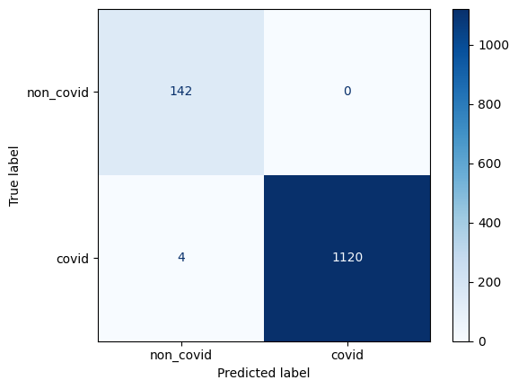
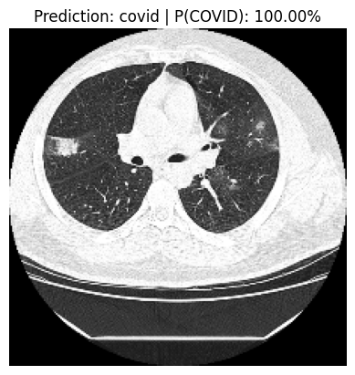

# COVID-19 Lung CT Scan Classification

[English](README.md) | [Bahasa Indonesia](README.id.md)

In this project, I train an image classification model to classify individual lung CT images as COVID-19 or non-COVID-19.

I use **EfficientNetV2B0 pretrained on ImageNet**. First, I train a new classifier while keeping the backbone frozen. Then, I unfreeze the backbone and fine-tune the model on my training dataset.

## Dataset

[COVID-19 Lung CT Scans on Kaggle](https://www.kaggle.com/datasets/mehradaria/covid19-lung-ct-scans)

| Class | Images |
|---|---:|
| `non_covid` | 944 |
| `covid` | 7,495 |
| Total | 8,439 |

I use a fixed stratified split: 5,907 training, 1,266 validation, and 1,266 test images. Since the classes are imbalanced, I apply class weights during training and use macro-F1 as the main evaluation metric. The dataset is downloaded separately.

## Training

I convert grayscale images to three channels and resize them to 224 × 224. Preprocessing is included in EfficientNetV2B0. Horizontal flips and small random rotations augment the training images.

| Parameter | Value |
|---|---:|
| Batch size | 16 |
| Classifier training | 2 epochs, Adam, learning rate `1e-3` |
| Fine-tuning | Up to 23 epochs, AdamW |
| Fine-tuning learning rate | `6e-5` |
| Weight decay | `1e-5` |
| Dropout | 0.4 |
| Early stopping patience | 5 epochs |
| Prediction threshold | 0.5 |
| Seed | 123 |

AdamW minimizes binary cross-entropy loss. I save the weights with the highest validation macro-F1 and stop fine-tuning after five consecutive epochs without improvement. BatchNormalization statistics remain fixed. The current notebook uses fixed hyperparameters and does not run Optuna.

## Results

Results from the saved test evaluation in `outputs/test_metrics.json`:

| Metric | Score |
|---|---:|
| Accuracy | 99.68% |
| Macro-F1 | 99.22% |
| COVID-19 precision | 100.00% |
| COVID-19 recall | 99.64% |

The model correctly classified 142 non-COVID images and 1,120 COVID images. Four COVID images were classified as non-COVID.

This is an example model prediction. The displayed probability is a model output, not clinical certainty.

## Run the notebook

1. Use Python 3.10 and install `requirements.txt` with `python -m pip install -r requirements.txt`.
2. Place the dataset in `ct_scans_dataset/covid/` and `ct_scans_dataset/non_covid/`.
3. Open `covid_ct_scans.ipynb`, select the correct Python kernel, and run the cells from the top.
4. Set `retrain = True` to train a new model. With `retrain = False`, the notebook loads `outputs/model.h5` if available and skips training.

The notebook requires a GPU detected by TensorFlow. For this Windows native setup, I use TensorFlow 2.10.1, Keras 2.10, CUDA 11.2, and cuDNN 8.1. Installing the Python requirements alone does not install CUDA/cuDNN. See the [TensorFlow installation guide](https://www.tensorflow.org/install/pip).

All hyperparameters are in the configuration cell. The `outputs` folder contains the model, best weights, split, configuration, training history, and test results. Preserve `split.csv` to reuse the same data split. The executed notebook is uploaded separately.

## Limitations

The split is per image, not per patient. Related slices from the same patient could appear in different splits, making the scores optimistic. These results do not establish performance on new patients or other hospitals. The model classifies individual CT images and is not intended for clinical diagnosis.
